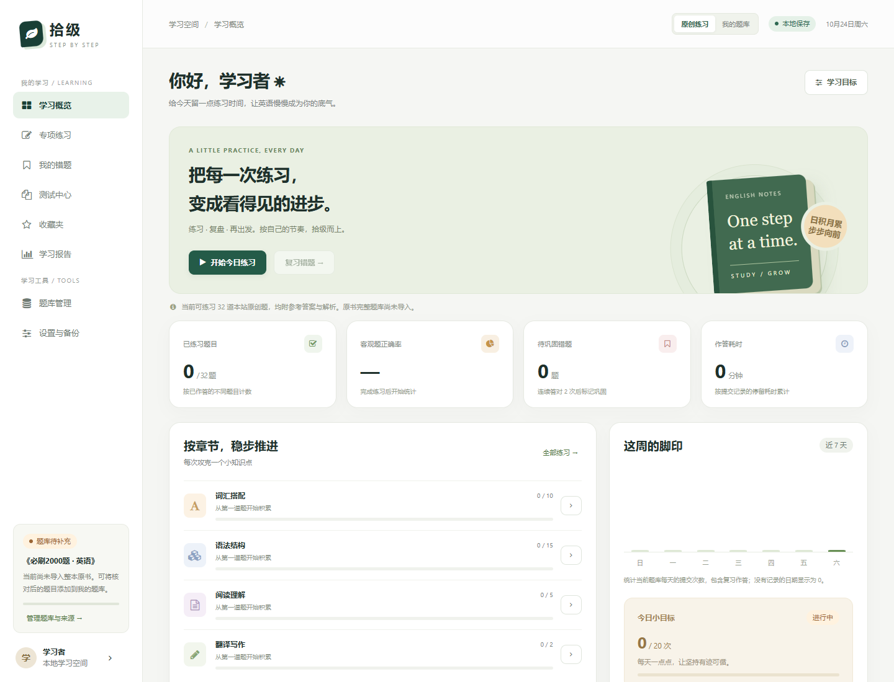

# 拾级 · 英语练习站

一个可以直接在浏览器中使用的英语练习网站，支持本地保存、错题复习、组卷测试、学习报告与个人题库管理。

**在线使用：<https://zjmnb66611.github.io/shiji-english-practice/>**



## 当前内容范围

- 内置 **32道原创练习题**，含参考答案与中文解析，覆盖词汇、语法、阅读、翻译和写作。
- 这些题目不是《专升本必刷2000题·英语》的原题；整本原书题库尚未收录。
- 原创题与用户导入题库分别管理、分别统计。导入内容须自行核对来源、题目、答案与解析。

## 功能

- 章节、题型、难度、关键词筛选；顺序或随机练习。
- 客观题自动判分，提交后查看答案和解析；翻译写作对照参考答案自评。
- 错题自动收录、复习提醒、连续答对两次后移入已巩固。
- 收藏和逐题笔记。
- 保存测试集合，设置题量与考试时长；刷新恢复作答，到时自动交卷。
- 历史成绩、逐题复盘、错题重练及打印。
- 学习报告、章节表现、练习覆盖率及每日目标。
- 手动录题、JSON / UTF-8 CSV导入、预览校验、逐题核对启用和导出。
- 完整备份恢复，包括题目、记录、笔记、收藏、试卷与进行中的作答。
- 桌面和手机布局；内置本地样式与图标资源作为CDN不可用时的备份。

## 使用

访问上方在线地址，或下载仓库后直接打开 `index.html`，不需要安装依赖或启动服务。

学习记录保存到当前浏览器，当前版本没有后端账号、云同步、班级管理、整本书自动OCR或AI语义评分。切换设备、浏览器、本地文件与在线地址时，请先导出完整备份，再在新的地址恢复。

详细操作及统计规则见 [使用说明](使用说明.md)。第三方字体、CSS许可及来源见 [第三方资源说明](第三方资源说明.md)。

## 题库导入

在“题库管理”下载JSON或CSV模板。导入后所有题目先进入待核对区，确认后才会用于练习。

单选 `single`、多选 `multiple`、填空 `blank`、翻译写作 `essay`。每题包含唯一ID、章节、知识点、题干、答案、解析和来源；可附页码、原题号及阅读材料。字段说明见使用说明。

## 本地检查

```bash
node --check core.js
node --check questions.js
node --check app.js
node tests/core.test.cjs
```

核心测试不需要安装依赖。桌面与手机浏览器流程还验证了判分、错题巩固、测试恢复、自动交卷、导入及备份恢复。2000道题容量测试使用的是合成数据，不代表已收录原书2000题。

## 文件结构

```text
index.html      网站入口
styles.css      响应式布局和打印样式
questions.js    32道原创练习
core.js         评分、校验、统计和复习逻辑
app.js          页面、交互和本地存储
assets/ fonts/  本地图标资源与上游说明
docs/           界面预览
tests/          无第三方依赖的核心测试
```

GitHub Pages从 `main` 分支根目录发布。`vercel.json` 同时保留其他静态托管平台所需的设置；页面不依赖服务器端逻辑。
